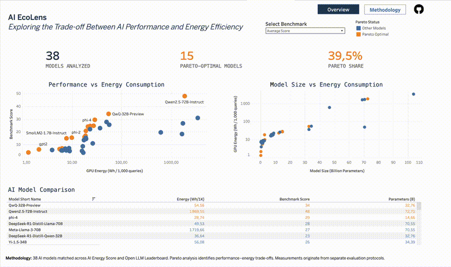

# AI EcoLens 🌱

**AI Model Performance & Energy Efficiency Analytics**

AI EcoLens is an end-to-end data engineering and analytics project exploring the trade-offs between AI model performance and inference energy consumption.

It combines public benchmark datasets, Python data processing, DuckDB SQL analytics, Pareto frontier analysis, and interactive Tableau visualizations.

**Research question:** How can we identify AI models that deliver competitive performance while minimizing inference energy consumption?

## 📊 Live Dashboard

**[Explore AI EcoLens on Tableau Public](https://public.tableau.com/views/AIEcoLensAIPerformanceEnergyEfficiency/AIEcoLensOverview)**

### Dashboard Preview



The interactive dashboard includes:

- **Energy vs. Performance:** Analyze inference energy consumption against model benchmark scores.
- **Energy vs. Model Size:** Explore relationships between model size and energy consumption.
- **Dynamic Benchmark Selection:** Compare MMLU-Pro, IFEval, and Average Score.
- **Pareto Frontier Analysis:** Identify non-dominated models based on energy and performance.
- **Model Comparison:** Explore individual models through interactive filtering and highlighting.
- **Methodology & Data Sources:** Review the analytical approach, metrics, and limitations.

## 🎯 Project Objectives

1. Integrate public AI model energy and performance datasets.
2. Clean, standardize, and match model records across sources.
3. Build an analytical data pipeline using Python and DuckDB.
4. Evaluate energy-performance trade-offs using Pareto optimization.
5. Export structured analytical datasets for Tableau.
6. Communicate results through an interactive dashboard.

## 🗂️ Data Sources

**[AI Energy Score](https://huggingface.github.io/AIEnergyScore/)**

Energy consumption measurements for AI model inference.

**[Open LLM Leaderboard](https://huggingface.co/spaces/open-llm-leaderboard/open_llm_leaderboard)**

Language-model performance evaluation results.

The current dataset contains **38 matched models**.

Energy and performance measurements come from different evaluation protocols. Results are therefore intended for exploratory comparison rather than controlled experimental benchmarking.

Source CSV files are stored locally under `data/raw/` and are not included in the Git repository. Their acquisition and preparation procedures must be documented separately.

## 🏗️ Data Architecture

```text
AI Energy Score        Open LLM Leaderboard
       |                       |
       +-----------+-----------+
                   |
                   v
            Python / pandas
       Ingestion and validation
       Cleaning and model matching
                   |
                   v
           Processed Dataset
    energy_quality_comparison.csv
                   |
                   v
                DuckDB
        Analytical SQL views
       Benchmark-specific Pareto
                   |
                   v
           Tableau CSV Exports
       tableau_model_metrics.csv
     tableau_benchmark_metrics.csv
                   |
                   v
             Tableau Public
        Interactive dashboards
```

### Project Structure

```text
ai-ecolens/
├── data/
│   ├── raw/              # Source datasets (Git-ignored)
│   ├── interim/          # Intermediate data
│   ├── processed/        # Cleaned and merged datasets
│   ├── warehouse/        # Local DuckDB database
│   └── analytics/        # Tableau-ready CSV exports
├── docs/
│   ├── data_sources.md
│   └── methodology.md
├── notebooks/
│   └── 01_energy_data_exploration.ipynb
├── scripts/
│   ├── run_pipeline.py
│   ├── run_sql.py
│   └── check_database.py
├── sql/
│   ├── 01_model_analysis.sql
│   ├── 02_pareto_frontier.sql
│   ├── 03_dashboard_dataset.sql
│   ├── 04_benchmark_pareto.sql
│   └── 05_benchmark_dashboard.sql
├── src/ai_ecolens/
│   ├── ingestion/
│   ├── processing/
│   ├── storage/
│   └── analytics/
├── tests/
│   ├── test_ingestion.py
│   └── test_metrics.py
├── requirements.txt
├── pyproject.toml
└── README.md
```

## 📐 Metrics & Methodology

| Metric | Description |
|---|---|
| GPU Energy (Wh/1K queries) | Normalized GPU energy consumption |
| MMLU-Pro | Knowledge and reasoning benchmark |
| IFEval | Instruction-following benchmark |
| Average Score | Aggregate performance metric |
| Model Size (B) | Number of parameters in billions |
| Pareto Optimality | Non-dominated energy-performance trade-off |

### Pareto Frontier Analysis

The analysis considers two competing objectives:

- **Minimize** inference energy consumption.
- **Maximize** model performance.

A model is Pareto-optimal when no other model in the comparison set performs at least as well on both objectives and strictly better on at least one.

Pareto analysis is performed separately for the available performance benchmarks.

## 📈 Key Results

The validated local pipeline produced:

| Indicator | Result |
|---|---:|
| Matched AI models | 38 |
| Model-benchmark observations | 114 |
| SQL transformation scripts | 5 |
| Automated tests passed | 3/3 |

### Pareto-Optimal Models by Benchmark

| Benchmark | Pareto-Optimal Models |
|---|---:|
| MMLU-Pro | 10 |
| IFEval | 9 |
| Average Score | 15 |

These results show that the set of non-dominated models changes according to the selected performance benchmark.

Pareto optimality is relative to the evaluated models and metrics; it does not establish that a model is universally more energy-efficient.

## 🛠️ Technology Stack

| Category | Technologies |
|---|---|
| Programming | Python |
| Data Processing | pandas, NumPy |
| Analytical Database | DuckDB |
| Data Transformations | SQL |
| Data Exploration | Jupyter Notebook |
| Visualization | Tableau Public |
| Testing | pytest |
| Version Control | Git, GitHub |

## 🚀 Getting Started

### Prerequisites

- Python 3.11+
- Git
- Source datasets placed in the expected local directories

### 1. Clone the repository

```bash
git clone https://github.com/EyaWal/ai-ecolens.git
cd ai-ecolens
```

### 2. Create a virtual environment

```bash
python3 -m venv .venv
source .venv/bin/activate
```

### 3. Install dependencies

```bash
python -m pip install -r requirements.txt
```

### 4. Prepare the source datasets

The pipeline expects the following local files:

```text
data/raw/
├── ai_energy_score/
│   ├── question_answering.csv
│   ├── summarization.csv
│   └── text_generation.csv
└── open_llm_leaderboard/
    └── open_llm_leaderboard.csv
```

These files are not distributed in the Git repository. The source download and preparation instructions are not yet fully documented.

### 5. Run the data pipeline

```bash
python -m scripts.run_pipeline
```

This generates the processed dataset and loads it into a local DuckDB database.

### 6. Run SQL analytics

```bash
python -m scripts.run_sql
```

This executes five SQL scripts and generates:

```text
data/analytics/tableau_model_metrics.csv
data/analytics/tableau_benchmark_metrics.csv
```

### 7. Run automated tests

```bash
python -m pytest -q
```

**Current local validation:** 3 tests passed. Both pipeline execution commands completed successfully.

## ⚠️ Limitations

- Energy and quality benchmarks may use different hardware, workloads, and evaluation conditions.
- Model matching across independent datasets may introduce uncertainty.
- GPU energy measurements do not represent total environmental or lifecycle impact.
- Pareto results depend on the available models and selected metrics.
- Source datasets are not automatically downloaded by the current pipeline.
- Full reproducibility from a fresh clone requires additional source-data documentation.

## 🗺️ Roadmap

- [x] Explore public AI benchmark datasets
- [x] Build Python ingestion and cleaning pipeline
- [x] Match energy and performance datasets
- [x] Implement DuckDB analytical transformations
- [x] Compute benchmark-specific Pareto frontiers
- [x] Export Tableau-ready datasets
- [x] Publish interactive Tableau dashboard
- [x] Validate existing automated tests
- [ ] Document source dataset acquisition
- [ ] Expand automated data validation
- [ ] Improve reproducibility from a fresh clone
- [ ] Investigate inference cost and carbon estimation
- [ ] Explore a use-case-based model selection simulator

## 📌 Project Status

**V1 — Interactive Analytics Dashboard Published**

The current implementation includes a working local data pipeline, SQL analytics, benchmark-specific Pareto analysis, and a published Tableau dashboard.

Future work will focus on reproducibility, broader benchmark coverage, and additional decision-support capabilities.